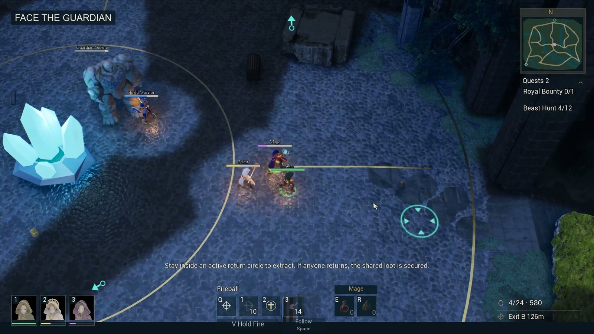
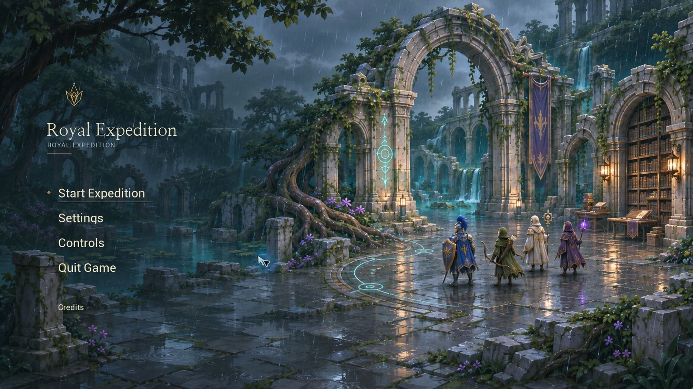
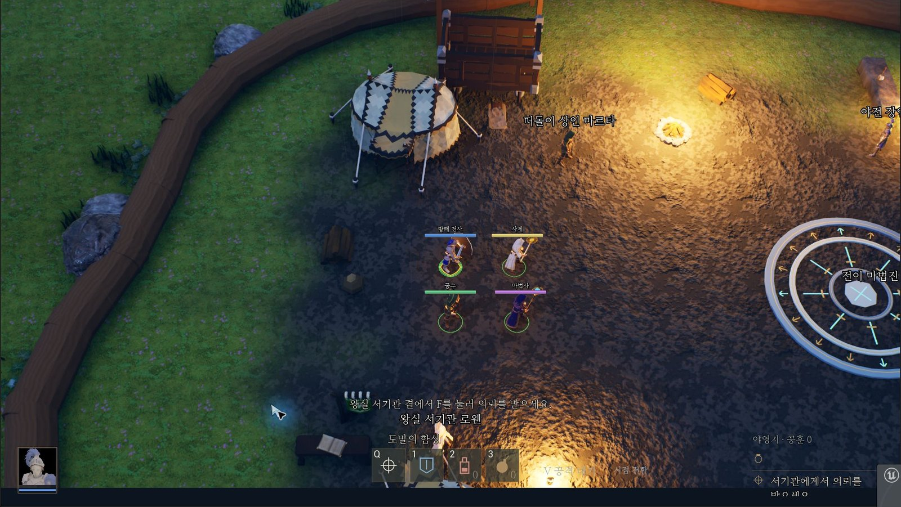
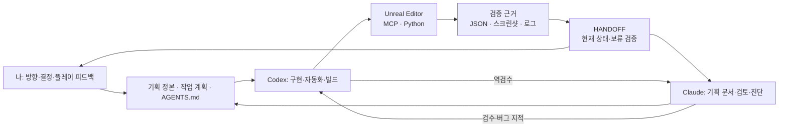
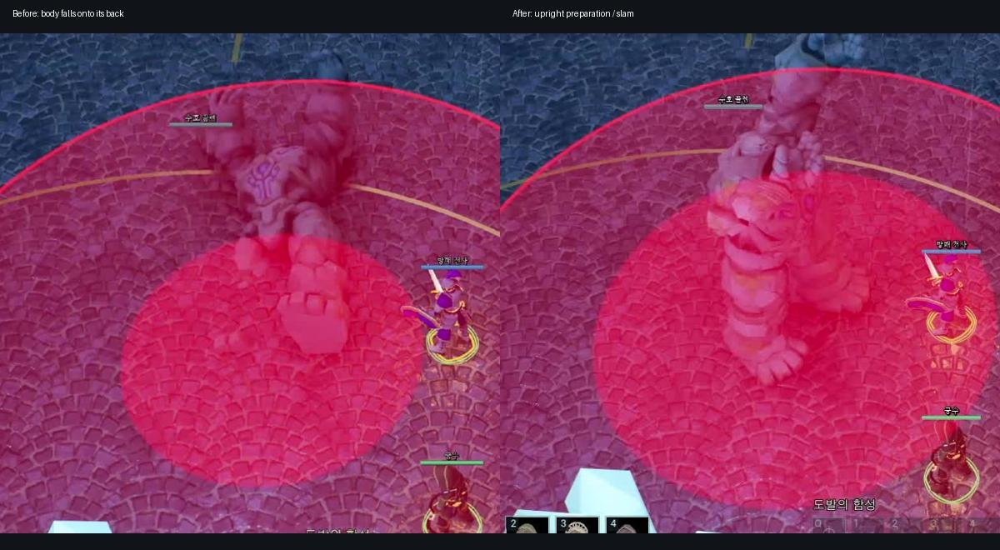
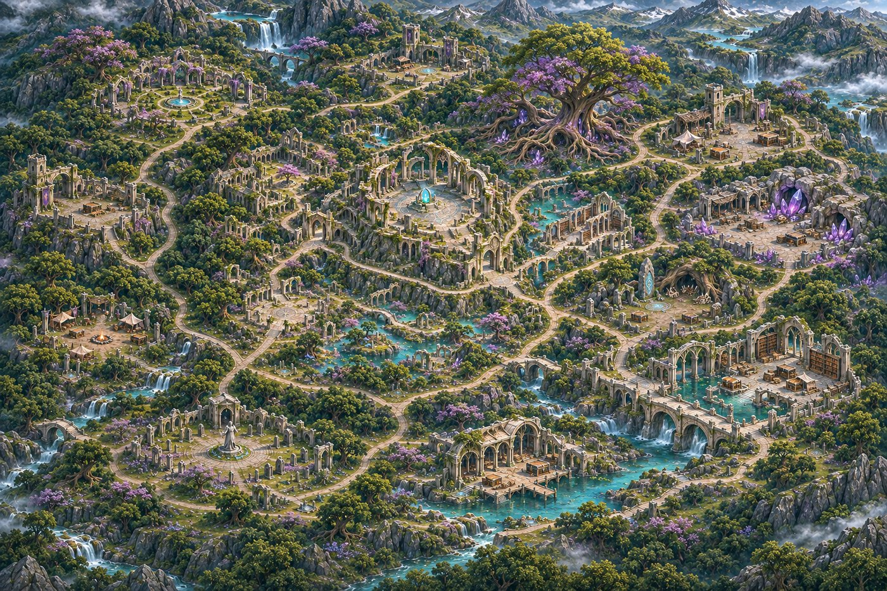

# Royal Expedition — AI 에이전트를 지휘해 4일 만에 만든 게임 | 상세 설명

[← 전체 프로젝트 목록](../../README.md)

4일짜리 1인 게임잼에서 AI를 어떻게 썼고, 좋은 결과를 얻기 위해 무엇을 했는지를 중심으로 정리했습니다. 게임 소개는 짧게 하고, 대부분을 AI 작업 방식에 썼습니다.

## 목차

- [프로젝트 소개](#section-1)
- [AI를 어떻게 나눠 썼나](#section-2)
- [좋은 결과를 뽑기 위해 한 것](#section-3)
- [4일 진행 기록](#section-4)
- [숫자로 본 결과](#section-5)
- [한계와 다음에 고칠 점](#section-6)

---

<a id="section-1"></a>

## 프로젝트 소개

> 왕국 원정대장이 원정대원 4명을 RTS처럼 지휘해 멸망한 마도 제국의 폐허에서 유물을 챙기고, 귀환 마법진으로 돌아오는 탑다운 PvE 익스트랙션입니다.



*실제 플레이 녹화에서 잘라 낸 보스(수호 골렘) 교전 화면입니다. 상단 문구는 제출 영상용 자막입니다.*

| 항목 | 내용 |
|---|---|
| 행사 | Epic AI MegaJam · 테마 `DIRECTOR'S CUT` |
| 작업 기간 | 2026.11.12–11.16 (마감 11.16 오전 10:59, 한국 시간) |
| 형태 | 1인 개발 · AI 에이전트 중심 |
| 기술 | Unreal Engine 5.9, C++, Blueprint, UMG, Enhanced Input, Niagara |
| AI 도구 | OpenAI Codex, Claude Code, OpenAI 이미지 생성(ChatGPT·Codex), Tripo Studio |
| 개발 도구 | Unreal MCP, Python·PowerShell 에디터 자동화, Blender, FFmpeg, butler |
| 링크 | [60초 플레이 영상](https://youtu.be/Qhb5zFiIp14) · [itch.io 페이지](https://acdok.itch.io/royal-expedition) |

### 구현된 기능

- **분대 지휘:** 다중 선택, 우클릭·WASD 이동, 자유 교전/공격 대기(V), 일제 공격(Alt+좌클릭), Q 공격 이동, Tab 선봉 전환
- **4직분:** 방패 전사·궁수·사제·마법사. 직분마다 기술과 고유 특성이 있으며 화염구·조준 사격은 클릭으로 조준
- **적 5종:** 부패한 마수, 스켈레톤 전사·궁수, 망령 근위병(준보스), 수호 골렘(보스). 보스는 바닥 예고 표시가 다 차오르면 터지는 범위 공격 사용
- **익스트랙션:** 공용 주머니, 적 전리품 자루, 랜드마크별 보관함, 유물 운반(이동 50% 감속), 귀환 마법진 10초, 빈사·구원
- **전장 정보:** 140° 시야와 벽·나무 차폐, 시야 밖 안개, 화면 밖 피격 방향, 사라진 적의 마지막 위치 표시, 소리에 반응하는 적
- **야영지:** 의뢰 수주·보고, 상인·창고·제작소, 보급품(물약·폭탄), 장비 강화, 짧은 이야기와 유물 보고 엔딩
- **화면:** 메인·일시정지 메뉴, 설정, 한국어/영어 전환(영어 기본), 결산 화면

| 메인 메뉴 (패키지 실행 화면) | 원정 야영지 (에디터 플레이 화면) |
|---|---|
|  |  |
| 배경 그림은 OpenAI 이미지 생성 결과입니다. | 서기관·상인·전이 마법진이 있는 출발 지점입니다. |

---

<a id="section-2"></a>

## AI를 어떻게 나눠 썼나

AI 도구 하나에 모든 일을 맡기지 않았습니다. 일의 성격에 따라 맡기는 범위와 맡기지 않는 범위를 나눴습니다.

| 도구 | 맡긴 일 | 맡기지 않은 일 |
|---|---|---|
| **OpenAI Codex** (주 구현) | TASK 단위 구현. C++ 작성, Unreal MCP와 Python 스크립트로 Blueprint·UMG·데이터 에셋·맵 편집, 빌드·패키징, 실행 화면 확인, 서브에이전트로 독립 읽기 검토 | 범위 결정, 외부 게시, 최종 제출 |
| **Claude Code** (기획·검수) | 작업 계획 검토, 범위 확장 요청을 기획 문서와 구현 계약으로 정리, 실제 에셋 값을 읽은 진단, 플레이 점검과 버그 수정, 일부 기능 구현(클릭 조준 기술), Codex 결과 검수 | 확장 기획 단계의 코드 수정 (문서만 작성하고 구현은 Codex에 넘김) |
| **OpenAI 이미지 생성** (ChatGPT, Codex 내장 도구) | 맵 컨셉 2종, 원정대 4직분 남녀 8종과 몬스터의 앞뒤 참고 이미지 24장, 메뉴 배경, 아이템 아이콘, UI 시안 | 게임 화면을 대신하는 이미지 |
| **Tripo Studio** | 참고 이미지를 3D 메시로 생성. 내가 웹에서 만들어 지정 폴더에 넣으면 에이전트가 임포트해 크기·피벗·충돌·재질을 맞춤 | API 유료 생성 (에이전트는 시도 금지) |
| **Blender** | 메시 가공 (예: 벚나무 꽃잎 4만여 개를 1.75배 확대) | — |



모든 요청은 문서를 거쳐 구현으로 들어가고, 결과는 검증 근거와 인계 문서로 돌아옵니다. 저는 그 기록과 실제 화면을 보고 다음 결정을 내렸습니다.

---

<a id="section-3"></a>

## 좋은 결과를 뽑기 위해 한 것

### 1. 코드보다 문서를 먼저 고정했다

첫날(11.12)에는 코드를 한 줄도 쓰지 않았습니다. 대신 AI가 읽고 따를 문서 다섯 개를 만들었습니다.

| 문서 | 역할 |
|---|---|
| `AGENTS.md` | AI 작업 규칙. 우선순위, 도구 사용법, 금지 사항, 검증·보고 기준 |
| 기획 정본 | **무엇을** 만드는가. 규칙·이름·수치의 단일 기준 |
| 작업 계획 | **무엇을 언제·어떻게** 만드는가. 필수/여유/제외 구분, TASK 순서, 코드·에셋 계약, 확인표 |
| 이관 문서 | 재사용할 이전 프로젝트 코드의 실제 상태와 옮기는 절차 |
| HANDOFF | 지금 상태만 기록. TASK당 10줄 이내, 지난 기록은 별도 보관 문서로 이동 |

문서끼리 내용이 다르면 정본을 따르고, 사용자 지시가 가장 우선이라는 순서도 적었습니다. 계획에는 "계획대로 게임 만들어줘"라는 지시 하나로 TASK-01~08을 재승인 없이 이어서 수행하도록 실행 절차까지 넣었습니다.

**결과:** 11.13 새벽 2시 21분에 구현을 시작했고, 오전 7시쯤에는 필수 TASK-01~07이 완료 상태였으며 첫 패키지로 한 판(선택·전투·줍기·유물 운반·귀환·결산·재출정 2회)을 완주한 기록이 남았습니다. 약 5시간 만에 제출 가능한 첫 후보가 생겼고, 이후 작업은 모두 이 후보를 보존한 채 진행했습니다.

### 2. AI가 바꿔도 되는 것과 안 되는 것을 표시했다

정본의 모든 규칙에 출처 표시를 달았습니다.

| 표시 | 의미 | AI의 권한 |
|---|---|---|
| `[사용자 확정]` | 대화에서 내가 정한 방향 | 지시 없이 변경 금지 |
| `[원본 유지]` | 이전 프로젝트에서 유지하는 조작·판정 원칙 | 지시 없이 변경 금지 |
| `[잼 제안]` | 조정 가능한 초기 이름·수치 | 근거와 함께 조정 가능 |
| `[미결정]` | 구현 전에 정해야 할 규칙 | 나에게 확인 |

예를 들어 "1명 이상 귀환하면 공용 전리품 전부 확보, 전멸하면 0"은 `[사용자 확정]`이었습니다. 이후 밸런스를 크게 손볼 때도 AI는 이 규칙을 건드리지 않았고, 바꿀 수치는 `[잼 제안]`으로 표시해 저에게 보여 줬습니다.

### 3. 범위를 줄이는 규칙을 AI에게 맡겼다

4일 안에 끝내려면 무엇을 만들지보다 무엇을 만들지 않을지가 중요했습니다. AI가 문서에 없는 기능이나 확장 구조를 끼워 넣지 않도록, 줄이는 기준을 문서에 넣었습니다.

- **필수/여유/제외:** 필수가 끝나고 첫 패키지를 확인하기 전에는 여유 항목에 손대지 않습니다. 여유 항목도 정해진 순서로만 넣습니다.
- **마네킹 먼저:** 첫 패키지 전에는 새 이미지 생성, 3D 생성, 리깅, 장식에 시간을 쓰지 않고 기본 도형과 마네킹으로 한 판을 먼저 완성합니다.
- **일정 여유:** 필수 작업량을 3일분으로 잡고 하루는 오류 수정과 제출물 준비에만 씁니다.
- **막히면 줄이는 순서:** 어떤 기능부터 버릴지를 미리 적어, 막혔을 때 AI가 임의로 판단하지 않게 했습니다.

초기 계획은 TASK 8개였지만, 플레이해 보고 "너무 간소화됐다"고 판단해 범위를 여러 번 넓혔고 최종적으로 TASK-39까지 늘었습니다. 범위를 넓힐 때도 같은 경로를 거쳤습니다.

```text
내 요청 → (Claude) 정본에 새 절 추가 + 작업 계획에 코드·에셋 계약과 확인표
        → 내가 문서 검토 → (Codex) 구현 → 검증 → HANDOFF
```

정본에는 "이 문서 갱신은 구현 완료를 뜻하지 않는다"고 명시해, 기획만 된 기능이 구현된 것으로 오해되지 않게 했습니다.

### 4. 기존 코드를 근거를 갖고 재사용하게 했다

이전에 만든 Colonization 프로토타입에 분대 선택·이동·명령 검증·카메라·HUD 코드가 있었습니다. AI에게 원본 소스를 직접 읽고 재사용 계획을 쓰게 했고, 다음 결정이 문서에 남았습니다.

- 런타임 모듈(약 1만 줄)은 **통째로 복사**합니다. 조작·명령·카메라 코드가 저장·신원 코드와 엮여 있어 골라내는 비용이 더 크기 때문입니다.
- 원본은 신원 5개가 고정입니다. 신원·검증 코드를 4명 기준으로 고치는 대신 **몸체만 4개 스폰**합니다. 원본이 1~5명 출정을 이미 지원한다는 점을 소스에서 확인한 결정입니다.
- 모듈·클래스·에셋 이름(`Colonization`, `Col` 접두사 등)은 **바꾸지 않습니다.** 바꾸면 Blueprint 부모 참조가 끊어집니다.
- 화면 문구는 C++에 넣지 않고 **UMG와 데이터 에셋에만** 둡니다. 잼 테마가 공개되면 문구를 다시 바꿔야 했기 때문입니다. 이 규칙 덕분에 화면 문구 전체를 번역 데이터 에셋 하나에 연결해 한국어/영어 전환을 만들 수 있었고, 마지막 날에는 영어를 기본 언어로 바꿨습니다.
- 원본 폴더는 읽기 전용입니다. 복사만 하고 원본은 수정하지 않습니다.

### 5. 두 AI에게 역할을 나누고 서로 검수하게 했다

`AGENTS.md`에 "Claude가 Codex 작업을 검수할 예정이니 꼬투리 잡히지 않게 하라"고 적었습니다. 두 AI의 결과를 비교해 앞으로 주로 쓸 AI를 정하겠다는 것도 적었습니다. 서로 검수한다는 사실을 처음부터 알려 두면, 각 AI가 완료 근거를 더 꼼꼼히 남길 것이라고 기대했습니다.

실제로 교차 검수에서 잡힌 것들입니다.

| 검수 | 발견한 문제와 처리 |
|---|---|
| Claude → 작업 계획 (11.13) | 마감·규정 확정, 신원 5·몸체 4, 재출정 시간 제한, 원본 커밋 고정, 조기 패키징, 제출 후보 관리, Git, 문서 동결. 범위를 바꾸지 않는 8가지를 계획에 반영 |
| Claude → 카메라·밸런스 진단 (11.15) | 휠 줌이 끝없이 멀어지는 원인은 Blueprint 값(`MaxDistance` 34,000)이었고, 그 값을 넣은 곳이 **자동화 스크립트의 한 줄**이었습니다. Blueprint만 고치면 스크립트를 다시 돌릴 때 되돌아가므로 원천을 고치도록 지적했습니다. 적 감지 거리(2,000)가 대원 시야(1,500)보다 길어 적이 늘 먼저 본다는 점, 사제의 무료 기본 치유 때문에 전투 후 항상 체력이 가득 찬다는 점도 실제 에셋 값을 읽어 계산했습니다. 계산값과 플레이 측정값을 구분해 적었습니다. |
| Claude → 플레이 점검 (11.16) | WASD 직접 이동은 내비게이션 메시를 따르지 않아, 물가의 충돌 없는 틈으로 나가면 4명이 끝없이 떨어지는 문제를 찾았습니다. 걸을 수 있는 바닥과 맞닿은 무충돌 칸 308개(54곳)를 확인하고, 대원이 낭떠러지로 걸어 나가지 않도록 막아 같은 실행에서 수정 전·후를 비교했습니다. |
| Codex → Claude의 클릭 조준 기술 | 조준 확정이 실제 클릭한 좌표 대신 다른 좌표를 쓰는 문제, 클릭한 적이 조건에 맞지 않으면 옆의 다른 적으로 바뀌는 문제를 찾아 수정하고 수정 전·후 기록을 남겼습니다. |
| Codex → 그림자 최적화 재측정 | Claude가 에디터 화면에서 측정한 그림자 개선(그림자 패스 약 11~12ms → 6ms)을 Codex가 패키지 실행 파일에서 다시 쟀습니다. 결과는 프레임 30.8ms → 29.2ms로 효과는 있었지만 작았고, "60fps 근거가 아니다"라는 단서와 함께 기록했습니다. |
| Codex 내부 독립 검토 | TASK를 닫기 전에 서브에이전트가 읽기 전용으로 검토하고, 주 에이전트가 그 지적을 직접 확인한 뒤 반영했습니다(예: 툴팁이 마우스에 반응하지 않던 설정, 겹친 메뉴의 표시 복원). |

### 6. 두 AI가 한 에디터를 쓸 때의 규칙을 만들었다

Unreal MCP는 에디터 하나에 붙고 요청을 게임 스레드에서 차례로 처리합니다. 마지막 날 Claude가 플레이 점검을 하던 중 같은 에디터에서 Codex가 다른 작업을 하면서 대원을 순간이동시키고 플레이를 멈췄습니다. Claude는 처음에 이것을 게임 버그로 오해했습니다.

그 뒤로 다음 규칙을 지켰습니다.

- MCP 호출, 같은 파일·에셋 수정, 빌드는 한 번에 하나만 합니다.
- 플레이·에셋 편집·빌드 전에 최근 작업 폴더와 에디터 로그를 보고 다른 에이전트가 작업 중인지 확인합니다.
- 다른 에이전트가 작업 중이면 읽기 전용으로만 일하고, 순서는 제가 정합니다.
- 다른 에이전트가 에디터를 쓰던 시간대의 관측은 검증 근거에서 뺍니다.

동시 작업 문제는 프롬프트를 잘 쓴다고 해결되지 않았습니다. 규칙으로 정해야 했습니다.

### 7. "완료"를 엄격하게 정의했다

AI의 "완료했습니다"를 그대로 믿지 않도록, 완료 조건을 하네스에 적었습니다. 실제 규칙 일부입니다.

```markdown
- 생성·자동 수정 결과를 제안으로 취급하고 변경 내용과 원본 검증 결과를 확인한다.
  성공률 문구, 도구 실행 성공, 캐시 상태를 게임 기능·성능 또는 컴파일 성공의 근거로 대신하지 않는다.
- 컴파일 성공과 게임플레이 성공을 따로 보고한다.
- 게임플레이·UI 동작은 실제 게임을 실행·조작하고 화면을 직접 확인한 뒤에만 완료로 표시한다.
- 확인하지 못한 항목은 "구현 완료·검증 보류"로 적는다: 무엇을, 왜 못 했는지, 재현 절차와 기대 결과.
- 같은 실패를 근거 없이 반복하지 않는다. 자동 수정·재검증은 최초 실패 후 최대 3회다.
- 측정하지 않은 성능 개선을 사실로 보고하지 않는다.
```

확인표에는 기대 결과를 숫자로 넣었습니다. 예를 들어 "일반 궤짝 180 + 서고 궤짝 410 = 590, 마수 의뢰 300이면 전원 귀환 890 / 1명 귀환 713 / 전멸 300"처럼 적어 두면, AI가 결산 화면을 보고 맞는지 바로 판단할 수 있습니다.

이 규칙이 실제로 작동한 예입니다.

- **도구 성공 ≠ 결과 성공:** 스크린샷 명령은 성공 응답을 돌려줬지만 해상도 인자가 빠져 이미지가 저장되지 않았습니다. 이 캡처는 근거에서 뺐습니다.
- **시험용 배치 구분:** 엔딩 화면을 빨리 보기 위해 임시 상태를 넣어 확인한 결과는 "화면 표시 확인"으로만 쓰고, 실제 유물 회수 → 귀환 → 보고 흐름은 따로 확인했습니다.
- **보안 경계:** 최종 실행 파일이 Windows 보안 정책에 막혔을 때 AI는 우회하거나 설정을 바꾸지 않고, 저에게 직접 실행을 요청했습니다.
- **근거 보관:** 작업 폴더에 검증용 JSON 1,100여 개와 스크린샷 900여 장이 남았습니다. HANDOFF에는 결론과 근거 파일 이름만 적었습니다.



*보스 수정 전후를 같은 조건에서 비교한 실제 에디터 플레이 화면입니다. 공격 중 골렘이 뒤로 눕던 문제(왼쪽)의 원인은 가산 애니메이션의 기준 자세 설정이었습니다. 수정 뒤 공격 중 머리와 발의 최소 높이 차이가 14cm에서 384cm로 바뀐 것을 수치로도 확인했습니다.*

### 8. 사람이 판단할 수 있게 같은 조건에서 비교하게 했다

미적 판단은 AI에게 맡기지 않았습니다. AI는 같은 조건의 비교 자료를 만들고, 고르는 것은 제가 했습니다.

| 내 피드백 | AI가 한 일 | 결정 |
|---|---|---|
| 시야 밖 안개가 너무 어두워 길이 안 보인다 | 같은 카메라 위치에서 수정 전·후 캡처. 밝기만 12% → 40%로 올리고, 시야 밖 적은 여전히 숨겨지는지 확인 | 적용 |
| 조명이 밋밋하다 | 4개 시점 × 4단계 밝기 캡처 비교표 | 내가 "강"을 선택 |
| 방패 전사의 방패가 안쪽을 본다 | 손잡이 방향 수정 후 대기·공격·이동 자세와 패키지에서 확인 | 적용 |
| 카메라로 맵 밖이 보인다 | 화면 네 모서리의 지면 교점으로 이동 범위 제한. 첫 제안 값이 한 출발 지점의 대원을 화면 밖으로 밀어낸다는 것을 투영 좌표로 확인하고 다시 보정 | 적용 |
| 전투가 닳지 않고 보스가 체력 덩어리다 | 비슷한 게임을 참고한 진단 문서와 수치 제안 | 문서를 검토하고 반영 지시 |
| 전장 HUD와 아이템 화면을 판타지답게 | 레퍼런스 게임 4개를 조사하고 이미지 생성으로 정적 시안 제작. "실제 UMG는 아직 구현하지 않은 정적 시안"이라고 명시 | 시안을 고른 뒤 실제 UMG에 반영 |



*OpenAI 이미지 생성으로 만든 맵 컨셉입니다. 게임 화면이 아니라 구도와 분위기 참고용이며, 실제 맵은 탑다운 시점에서 읽히도록 길·랜드마크·조명·카메라를 여러 번 고쳐 만들었습니다.*

### 9. 비용과 외부 행동에 선을 그었다

- **유료 생성 금지:** Tripo API 크레딧은 0이었습니다. 에이전트는 유료 생성이나 충전을 시도하지 않고, 제가 Studio 웹에서 만든 파일을 지정 폴더에 넣으면 그때 임포트했습니다.
- **외부 게시는 승인 뒤에만:** 업로드는 제가 "butler 업로드 해줘"라고 한 뒤에 실행했습니다. AI는 잼 양식의 영문 답변을 채우고 백업본을 만들었지만, 규정 동의와 최종 제출은 제가 직접 하도록 남겨 두었습니다.
- **비밀값 금지:** API 키는 채팅·문서·저장소에 적지 않았습니다.
- **사용량 운영:** 남은 사용량을 기준으로 구현 70%·검증과 수정 20%·예비 10%로 배분하는 운영 기준을 세웠습니다. 다만 AI가 실제 사용량을 조회할 수 없으므로 이 비율을 측정값처럼 보고하지 못하게 했습니다.

### 10. 세션이 바뀌어도 이어지게 했다

토큰이 떨어지거나 Codex와 Claude를 오갈 때마다 처음부터 다시 조사하면 시간과 사용량이 낭비됩니다. 그래서 다음 원칙을 정했습니다.

- 새 세션은 작업 계획의 해당 TASK와 HANDOFF만 읽고, 필요한 파일로 범위를 좁힙니다.
- HANDOFF에는 현재 상태, 바뀐 파일, 실제 빌드·실행 결과, 남은 미검증 항목, 다음 할 일 하나를 남깁니다.
- 이미 끝난 작업은 HANDOFF와 실제 파일로 확인하고 이어 갑니다. 원본으로 덮어쓰지 않습니다.
- 에셋 편집은 Python 스크립트로 남겨 다시 실행할 수 있게 했습니다(약 95개). 다른 세션이 같은 결과를 재현할 수 있고, 무엇이 바뀌었는지 코드로 추적됩니다.

---

<a id="section-4"></a>

## 4일 진행 기록

| 날짜 | 한 일 |
|---|---|
| **11.12** | 기획 정본, 작업 계획(TASK-01~08), 이관 문서, `AGENTS.md` 작성. 맵 컨셉 2종과 캐릭터·몬스터 참고 이미지 24장 생성. 마법사와 스켈레톤 2종을 필수로 추가. **코드는 작성하지 않음** |
| **11.13** | 새벽 2시 21분 구현 착수 → 원본 이관과 4인 조작 → 4직분 전투와 공용 적 AI → 줍기·귀환·결산·재출정 → 기술 4개·적 5종 → 확장 맵 → **오전 7시쯤 첫 패키지에서 한 판 완주.** 이후 판타지 외형 개편과 Tripo 메시 적용 |
| **11.14** | "너무 간소화됐다"는 판단으로 빈사·구원, 적 전리품, 전장 정보, 원정 야영지·의뢰 추가. 140° 시야와 차폐, 랜드마크 보관함, 메뉴·설정·한영 전환. 이어서 야영지 시설·이야기·조명·사운드·이펙트의 확장 기획(Claude) |
| **11.15** | 상인·창고·제작소, 보급품, 이야기, 조명 선택, 사운드, 전투 이펙트 구현. Claude의 카메라·밸런스 진단을 반영해 보스 크기·예고형 범위 공격. Q 공격 이동, 대원 얼굴 초상화, 클릭 조준 기술 |
| **11.16** | 영어 기본값, 전사 접근 공격, 장비 구매와 능력치 미리보기, 몬스터 모션·이펙트·사운드, 보스 애니메이션 수정, Claude 플레이 점검(낙하 버그·그림자), 유물 보고 엔딩과 카메라 제한, 60초 영상 편집, 업로드 |

---

<a id="section-5"></a>

## 숫자로 본 결과

| 항목 | 값 |
|---|---|
| TASK | 계획 8개 → 최종 39개 |
| 새 C++ (잼 전용 폴더) | 82개 파일, 약 1.29만 줄. 이관한 기존 코드를 합친 모듈 전체는 146개 파일, 약 2.67만 줄 |
| 에디터 자동화 스크립트 | Python·PowerShell 약 95개 (Python 약 2.8만 줄) |
| 기획 문서 | 정본 약 1,570줄, 작업 계획 약 1,270줄 |
| 검증 근거 | JSON 1,100여 개, 스크린샷 900여 장 |
| 번역 | 화면 문구 358항목 한국어/영어 |
| 첫 플레이 가능 패키지 | 구현 착수 후 약 5시간 |
| 최종 패키지 | Windows, 약 2.36GB (압축 약 2.05GB) |

줄 수는 빈 줄과 주석을 포함한 단순 집계입니다.

---

<a id="section-6"></a>

## 한계와 다음에 고칠 점

**검증하지 못한 것**

- 제출시간 상 일부 지형 통행과 의뢰 경계 조합은 마감 때문에 검증을 보류했습니다. 대원이 떨어지는 것은 막았지만 맵의 무충돌 틈 자체는 남아 있습니다.


**다음에 고칠 점**

- **범위 확장을 더 일찍 끊어야 했습니다.** 8개였던 TASK가 39개까지 늘면서, 뒤로 갈수록 TASK마다 할 수 있는 검증의 폭이 줄었습니다. 하네스 덕분에 확장을 흡수할 수는 있었지만, 확장 자체를 줄이는 것은 제 판단의 몫이었습니다.
- **문서가 사람이 읽기 어려울 만큼 커졌습니다.** 확장 요청을 정본과 계획에 계속 덧붙이다 보니 두 문서가 각각 1,000줄을 넘었고, HANDOFF는 수치가 빽빽해졌습니다. 하지만 AI에게 핵심 문서를 요약해 사용자가 읽기 쉽게 했습니다. 

**정리하면**, AI는 반복 횟수를 크게 늘려 줬지만 게임의 일관성을 지키고, 방향에서 벗어난 결과를 거절하고, 실제로 검증된 것과 아닌 것을 구분하는 일은 여전히 사람의 몫이었습니다. 이번 프로젝트에서 가장 효과가 컸던 것은 프롬프트 문장보다, 그 판단을 문서와 규칙으로 미리 정해 둔 것이었습니다.
저는 일정 구간마다 체크포인트를 두고, 해당 체크포인트까지 AI가 수행한 것들을 한꺼번에 검증하고 피드백했습니다. 기능1개당 사람이 검증을 하는것보다 훨씬 효율적인 방식이었습니다.
