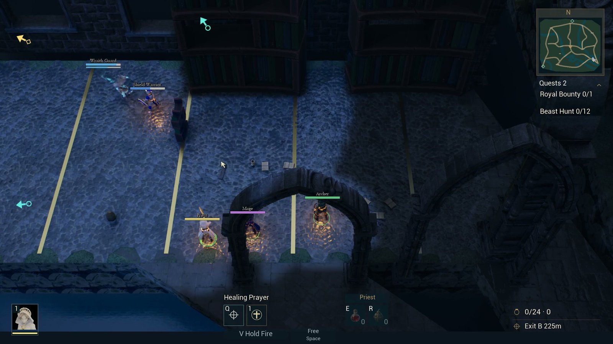

# Royal Expedition — AI 에이전트를 지휘해 4일 만에 만든 판타지 원정대 익스트랙션

> 구현은 Codex에, 기획 검토·진단은 Claude에 나눠 맡기고, 문서 하네스로 범위와 완료 기준을 통제해 4일 동안 1인으로 만든 Unreal Engine 5.9 게임잼 프로젝트입니다.



*개발 빌드 플레이 녹화에서 잘라 낸 실제 화면입니다. 망령 근위병과 교전하는 4인 원정대와 전장 HUD가 보입니다.*

## 프로젝트 개요

| 항목 | 내용 |
|---|---|
| 행사 | Epic AI MegaJam · 테마 `DIRECTOR'S CUT` |
| 작업 기간 | 2026.11.12–11.16 · 첫날 기획·하네스, 11.13부터 구현 |
| 형태 | 1인 개발 · AI 에이전트 중심 |
| 장르 | 탑다운 판타지 PvE 익스트랙션 · 4인 분대를 RTS처럼 지휘 |
| 기술 | Unreal Engine 5.9, C++, Blueprint, UMG, Enhanced Input, Niagara |
| AI 도구 | OpenAI Codex, Claude Code, OpenAI 이미지 생성(ChatGPT·Codex), Tripo Studio |
| 개발 도구 | Unreal MCP(엔진 내장 실험 기능), Python·PowerShell 에디터 자동화, Blender, FFmpeg, butler |
| 실행 산출물 | Windows 패키지 · [60초 플레이 영상](https://youtu.be/Qhb5zFiIp14) · [itch.io 페이지](https://acdok.itch.io/royal-expedition) |

이 기록에서 보여 주고 싶은 것은 AI가 게임을 대신 만들어 줬다는 사실이 아닙니다. AI가 기대한 결과를 내도록 무엇을 문서로 고정했고, 어떻게 역할을 나눴고, 무엇을 완료로 인정했는지가 핵심입니다.

## 기여와 소유권

| 구분 | 범위 |
|---|---|
| 본인 | 게임 방향과 범위 결정, 하네스(`AGENTS.md`)와 문서 체계 설계, AI 역할 분담, 플레이 피드백, 시안 선택, 산출물 채택·반려, 업로드 승인과 제출 |
| OpenAI Codex | 작업 단위(TASK) 구현: C++, Unreal MCP·Python으로 Blueprint·UMG·데이터 에셋·맵 편집, 빌드·패키징, 직접 조작 검증, 서브에이전트 독립 검토 |
| Claude Code | 계획 검토, 범위 확장 요청의 기획 문서화, 실제 에셋 값을 읽은 카메라·밸런스 진단, 플레이 점검과 버그 수정, 일부 기능 구현, Codex 결과 검수 |
| OpenAI 이미지 생성 | 맵 컨셉, 캐릭터·몬스터 앞뒤 참고 이미지, 메뉴 배경, 아이템 아이콘, UI 시안 |
| 기존 자산 | 이전 Colonization 프로토타입의 분대 조작 기반 코드(선택·이동·명령 검증·카메라·입력·HUD), Fab 환경 에셋(Paragon, Quixel 등), CC0 음원, 언리얼 마네킹 |

모든 코드와 에셋을 혼자 새로 만들었다고 주장하지 않습니다. 기존 프로토타입 코드와 외부 에셋 위에, 이번 잼에서 판타지 전투·적·전리품·귀환·의뢰·야영지를 새로 얹었습니다.

## 한 판의 흐름

```text
야영지에서 왕실 서기관에게 의뢰 수주 (5개 중 최대 2개)
  → 전이 마법진으로 출정, 방패 전사·궁수·사제·마법사 4명을 지휘
  → 폐허 탐사 · 보관함 수색 · 적 처치 → 원정대 공용 주머니
  → 귀환 마법진에서 10초 버티기 (1명 이상 귀환하면 전리품 확보, 전멸하면 0)
  → 결산 → 야영지에서 의뢰 보고 · 상인 · 창고 · 제작소 → 재출정
  → 왕실 유물을 들고 돌아와 보고하면 마지막 선택과 엔딩
```

자세한 내용은 [상세 설명](DETAILS.md)에 정리했습니다. 특히 [좋은 결과를 뽑기 위해 한 것](DETAILS.md#section-3)이 이 문서의 중심입니다.
